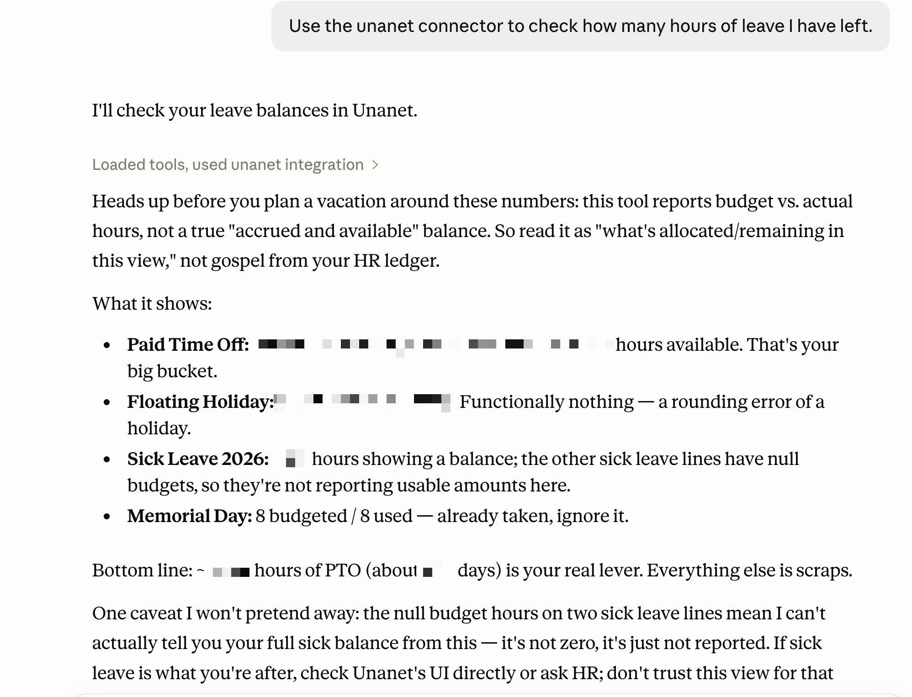

# Unanet MCP Server for Claude Desktop

> [!WARNING]
> **Writing to timesheets is turned off by default. If you decide to change
> this, be very careful, and always keep a human in the loop.**
> These tools can add, edit, delete, and submit real time entries on a live
> government-contract ERP. An AI assistant can misread a request or pick the
> wrong project, date, or hours. **Before submitting any timesheet, review it
> yourself in Unanet and confirm every entry is correct.** Submission is
> one-way and locks the timesheet. Never let an agent submit on your behalf
> without your own final check.

This fork lets Claude Desktop talk to Nava's Unanet GovCon instance through the Model Context Protocol (MCP). It has been substantially updated from the original API-key design to use Unanet Platform REST: username/password login, short-lived bearer tokens, and safe-by-default tool registration.

The happy path is macOS + Claude Desktop.

## What works today

The server exposes the Unanet Platform REST API in **three tiers**, so the default surface stays small and safe while the full API is reachable when you opt in:

| Tier | Flag | Tools | What it covers |
| --- | --- | --- | --- |
| Self-service reads (default) | — | 33 | Your own leave balances/requests, expense reports (lines, history, receipts, meal caps, imported card transactions), timesheets (periods, history, adjustments, attachments), the approval and review queues addressed to you, My Projects, rates, alternates. |
| Extended reads | `UNANET_ENABLE_EXTENDED_READ_TOOLS=true` | 22 | Org-level reads: projects/tasks/assignments/notes/admins, people, organizations, contracts, invoices, reference lookups — plus a **spec-driven catalog and read-only generic reader** (`unanet_api_search_operations`, `unanet_api_describe_operation`, `unanet_api_read`) for the read-classified operations in the OpenAPI spec. |
| Writes | `UNANET_ENABLE_WRITE_TOOLS=true` | 39 | 35 live writes plus 4 legacy stubs that always fail closed. Timesheet/expense/leave create-edit-submit, approve/disapprove, reviews, My Projects, attachments, and assigning people to a project. **Every live write requires `confirm: true`**; timesheet and expense submits validate first and hold on warnings. There is no generic API writer: a write exists only as a dedicated tool with its own guards. |

The Unanet spec has 1,267 operations. Dedicated tools cover the self-service and common workflows. `unanet_api_read` can run 580 read-classified operations (GET, or POST search/retrieve), including ones that also have a dedicated tool. The 471 operations classified **sensitive** are refused: workflow verbs (submit/approve/post/void/send…), deletes, auth, and reads that can return credentials, tokens, bank, payroll, person or project cost-rate or configuration data. Other fields such as tax ids and bank/account numbers are replaced with `[redacted]` in `unanet_api_read` output and in `includeRaw` payloads. The 216 plain create/update operations are not reachable except through a dedicated tool.

Example in Claude Desktop:



## Quick install for Mac users

### 1. Install Node.js

Install Node.js **20 or newer** from:

```text
https://nodejs.org/
```

Choose the current LTS installer for macOS.

### 2. Download or clone this repo

If you use Git:

```bash
git clone https://github.com/navapbc/unanet-mcp-server.git
cd unanet-mcp-server
```

If you downloaded a ZIP, unzip it and open Terminal in the project folder.

### 3. Run the Mac setup script

```bash
./setup-mac.sh
```

The script will:

1. Check Node.js/npm.
2. Install dependencies.
3. Build the server.
4. Create a local `.env` file if needed.
5. Add this MCP server to Claude Desktop's config.

Your password stays in the local `.env` file. It is not written into Claude Desktop's config.

### 4. Restart Claude Desktop

Fully quit and reopen Claude Desktop.

Then ask Claude:

```text
Show my Unanet leave balances.
```

If Claude can use the tool, the install worked.

## Manual Mac install

Use this if you prefer to see each step.

### 1. Build the server

```bash
cd /Users/YOU/path/to/unanet-mcp-server
npm install
npm run build
```

### 2. Create `.env`

```bash
cp .env.example .env
```

Edit `.env`:

```env
UNANET_BASE_URL=https://navapbc.unanet.biz
UNANET_USERNAME=your-username
UNANET_PASSWORD=your-password
UNANET_APP_NAME=NavaUnanetMCP

# Safe default: only self-service read tools are exposed.
UNANET_ENABLE_EXTENDED_READ_TOOLS=false
UNANET_ENABLE_WRITE_TOOLS=false
```

To expose org-level read tools and the generic API catalog/reader:

```env
UNANET_ENABLE_EXTENDED_READ_TOOLS=true
```

To expose write-capable tools:

```env
UNANET_ENABLE_WRITE_TOOLS=true
```

Only enable write tools when you intentionally want Claude to see them. Every write requires `confirm: true`; a few legacy CRM/budget stubs still fail closed because Platform REST has no matching endpoint.

### 3. Add the server to Claude Desktop

Edit:

```text
~/Library/Application Support/Claude/claude_desktop_config.json
```

Add or merge this entry:

```json
{
  "mcpServers": {
    "unanet": {
      "command": "/bin/bash",
      "args": [
        "-lc",
        "cd /absolute/path/to/unanet-mcp-server && node dist/index.js"
      ]
    }
  }
}
```

Why use `bash -lc`? The server loads `.env` from the project directory, so Claude needs to start it from that folder.

Restart Claude Desktop after changing the config.

## Environment variables

| Variable | Required | Default | Purpose |
| --- | --- | --- | --- |
| `UNANET_BASE_URL` | Yes | `https://navapbc.unanet.biz` | Unanet tenant origin. Do not include `/platform/rest`. |
| `UNANET_USERNAME` | Yes | — | Your Unanet username. |
| `UNANET_PASSWORD` | Yes | — | Your Unanet password. |
| `UNANET_APP_NAME` | No | `NavaUnanetMCP` | Value sent in the `X-Una-App` header. |
| `UNANET_ENABLE_EXTENDED_READ_TOOLS` | No | `false` | Enables org-level read tools, MCP resources, and the API catalog/read-only reader. The old `UNANET_ENABLE_LEGACY_READ_TOOLS` flag is no longer supported: it has no effect and the server logs a warning if it is set. |
| `UNANET_ENABLE_WRITE_TOOLS` | No | `false` | Enables mutating tools (all require `confirm: true`). Use carefully. |
| `UNANET_ALLOWED_BASE_URLS` | No | Nava tenant only | Comma-separated allow-list for additional production origins. |
| `UNANET_ALLOW_INSECURE_LOCAL_MOCK` | No | `false` | Allows `http://localhost` / `127.0.0.1` for local mock testing only. |
| `LOG_LEVEL` | No | `info` | Reserved for logging behavior. |

Legacy `UNANET_API_KEY` and `UNANET_FIRM_CODE` are no longer needed for the Platform REST tools in this fork.

## Tool surface

Descriptions below are the tools' own MCP descriptions (what Claude sees).

### Tier 1 — self-service read tools (default)

| Tool | Description |
| --- | --- |
| `unanet_get_my_leave_balances` | Read your Nava Unanet leave balances for a date range. This tool is read-only and returns minimized fields. |
| `unanet_get_my_leave_requests` | List your Unanet leave requests, optionally filtered by date range and status. Read-only. |
| `unanet_get_leave_request_history` | Read the status history of one of your Unanet leave requests. |
| `unanet_get_my_expenses` | Read your Unanet expense reports and return minimized report/detail fields. This is read-only. |
| `unanet_get_personal_development_fund_status` | Estimate personal/professional development spending from your Unanet expense reports. Remaining balance is only calculated when a budget amount is provided. |
| `unanet_get_my_expense_report` | Read one of your Unanet expense reports, optionally including validation results. |
| `unanet_get_expense_reference_data` | Read Unanet expense types, payment methods, and currency codes needed before drafting expense reports. |
| `unanet_validate_expense_report` | Validate a draft Unanet expense report without submitting it. |
| `unanet_get_expense_attachments` | List the receipt attachments on one of your Unanet expense reports. This is read-only and does not return file bytes. |
| `unanet_get_expense_attachment` | Download one receipt attachment from one of your Unanet expense reports. Pass saveTo to write it to a local path, or includeData=true to receive base64 inline. Read-only. |
| `unanet_get_expense_detail` | Read one line item (expense detail) of one of your Unanet expense reports, including its wizard fields. Read-only. |
| `unanet_get_expense_history` | Read the status history (submitted/approved/disapproved, by whom, when, comments) of one of your Unanet expense reports. Read-only. |
| `unanet_get_expense_meal_caps` | Read the daily meal cap and per-day meal totals Unanet computes for one of your expense reports (useful before adding M&IE lines). Read-only. |
| `unanet_get_approved_expense_requests` | List your approved Unanet expense REQUESTS (pre-approvals / travel authorizations), or read one by id. Read-only. |
| `unanet_search_imported_expenses` | Search your imported (corporate credit-card) expense transactions in Unanet, e.g. AVAILABLE ones not yet placed on a report. Read-only. |
| `unanet_get_timesheets` | Retrieve timesheets for a date range via Platform REST, including entry-level timeslip summaries. |
| `unanet_list_my_timesheets` | List your Unanet timesheets (summary rows only, no per-entry detail). Filter to active (open) timesheets, or list timesheets of a person you are a time alternate for via ownerKey. For date-range detail use unanet_get_timesheets. |
| `unanet_get_my_timesheet_projects` | List projects available to charge on your timesheet for a given date. |
| `unanet_get_time_periods` | List your Unanet time periods (pay periods) in a date range, including projected future periods. Useful to find which period a date falls in before creating a timesheet. |
| `unanet_get_timesheet_history` | Read the status history (submitted, approved, disapproved, etc. with who/when/comments) of one of your Unanet timesheets. |
| `unanet_get_timesheet_adjustments` | Read pending/completed adjustments (post-approval changes) on one of your Unanet timesheets. |
| `unanet_get_timesheet_attachments` | List attachments (metadata only) on one of your Unanet timesheets. Use unanet_get_timesheet_attachment to download one. |
| `unanet_get_timesheet_attachment` | Download one attachment from one of your Unanet timesheets. Returns metadata; pass saveTo to write the file to a local path, or includeData=true to receive base64 bytes inline. |
| `unanet_get_my_pending_approvals` | List items waiting for YOUR approval in Unanet: timesheets, expense reports/requests, invoices and leave requests, as manager, project approver and/or customer. Defaults to all types and roles you hold; queues you lack the role for are reported in endpointErrors rather than failing the call. Read-only. |
| `unanet_get_approval_detail` | Read one item from your manager approval queue by key (timesheet or expense report), including the manager approval preview message for timesheets. Read-only. |
| `unanet_get_approval_alternates` | List the primary approvers who have pending approvals that you can act on as their alternate (manager and project-approver alternates). Read-only. |
| `unanet_get_my_pending_reviews` | List Unanet timesheet/expense reviews waiting on you, as the owner (your own submissions) or as manager/project-approver/customer. Read-only. |
| `unanet_get_my_projects_list` | Read your Unanet 'My Projects' list: the project/task favourites shown on your timesheet. Read-only. (Distinct from unanet_get_my_timesheet_projects, which lists everything chargeable on a date.) |
| `unanet_search_available_projects` | Search projects/tasks you are eligible to add to your Unanet 'My Projects' list, by title, task name, organization, manager, type or status. Read-only. |
| `unanet_get_my_rates` | Read your Unanet person rate records (classification such as EXEMPT/NON_EXEMPT and effective dates). Read-only; sensitive personal compensation context. |
| `unanet_get_my_alternates` | Read your Unanet alternate approvers (people who can act for you) and, with direction=for, the people you are an alternate FOR. Read-only. |
| `unanet_get_my_attachments` | List attachments on your Unanet person record (metadata only), or download one by attachmentId (pass saveTo to write to disk). Read-only. |
| `unanet_ping` | Health check: confirms the Unanet Platform REST API is reachable and returns its version. Read-only, no data access. |

### Tier 2 — extended read tools

Requires:

```env
UNANET_ENABLE_EXTENDED_READ_TOOLS=true
```

| Tool | Description |
| --- | --- |
| `unanet_get_projects` | Search projects from Unanet Platform REST |
| `unanet_get_project_details` | Get detailed information about a specific Platform REST project key |
| `unanet_get_project_status` | Get current status data for a project from Platform REST |
| `unanet_get_project_tasks` | List the tasks (WBS) of a Unanet project, or search tasks across projects by name/number. Read-only. |
| `unanet_get_project_assignments` | List who is assigned to a Unanet project (people assignments), optionally filtered by person, task or date range. Read-only. |
| `unanet_get_project_notes` | List notes recorded on a Unanet project. Read-only. |
| `unanet_get_project_admins` | Read the administrative roles on a Unanet project: primary/alternate managers, project approvers, leads, billing managers, customers, viewers. Read-only. |
| `unanet_search_people` | Search Unanet people (employees/contractors) by name, email, person code, organization, labor category, etc. Returns what your Unanet role permits. Read-only. |
| `unanet_get_person` | Read one Unanet person record by key, optionally with their project assignments and leave balances. Read-only. |
| `unanet_search_organizations` | Search Unanet organizations (customers, vendors, internal orgs) by name/code, with active/legal-entity/vendor filters. Read-only. |
| `unanet_get_organization` | Read one Unanet organization by key, optionally with its contacts and addresses. Read-only. (Supersedes unanet_get_company_info.) |
| `unanet_get_company_info` | Get detailed information about a Platform REST organization/company |
| `unanet_search_contracts` | Search Unanet contracts by code/title, status, type, customer org, NAICS, or award dates. Read-only. |
| `unanet_get_contract` | Read one Unanet contract by key, optionally with its associated projects and modifications. Read-only. |
| `unanet_search_invoices` | Search Unanet customer invoices by number, keys, or invoice/created/completed/posted date ranges. Read-only. |
| `unanet_get_invoice` | Read one Unanet customer invoice by key, optionally with its status history and transaction summary. Read-only. |
| `unanet_get_billing_status` | Get billing-adjacent project invoice setup and accounts from Platform REST |
| `unanet_get_financial_report` | Retrieve invoice-oriented financial data via Platform REST invoice search |
| `unanet_get_reference_data` | Read a Unanet reference/lookup list by kind. Kinds: laborCategories, projectTypes, projectStatuses, payCodes, locations, employeeTypes, organizationTypes, occupations, paymentTerms, industries, naicsCodes, socioeconomicStatuses, costStructures, costElements, changeReasons, expenseVendors, vatLocations, mileageRates, accounts, statisticalAccounts, businessWeeks, fiscalYears, timePeriodSetups, skillTypes, skillLevels, planSetNames, invoiceFormats, contractTypes, contractStatuses, customLinks, expenseTypes, paymentMethods, currencies. Use these keys when other tools need e.g. laborCategoryKey, payCodeKey, projectTypeKey, expenseTypeKey. Read-only. |
| `unanet_api_search_operations` | Search the full Unanet Platform REST API catalog (1,200+ operations) by keyword, resource group (tag), HTTP method and kind (read/write/sensitive). With no query it returns the list of tags with counts. Use the result's id/method/path with unanet_api_describe_operation or unanet_api_read. Read-only, offline (no Unanet call). |
| `unanet_api_describe_operation` | Describe one Unanet API operation from the catalog: parameters, request body schema (expanded), response schema, and whether unanet_api_read may execute it. Identify by operationId, or by method + path. Read-only, offline. |
| `unanet_api_read` | Execute any READ-classified Unanet API operation from the catalog (GET, or POST search/retrieve endpoints) and return the raw JSON. Refuses write/sensitive operations. Use unanet_api_describe_operation first to learn the parameters. Large responses are truncated. |

The three `unanet_api_*` tools work from `spec/api-catalog.json` (generated from the committed OpenAPI spec by `npm run build-catalog`). Each of the 1,267 operations is classified **read** (GET or POST search/retrieve), **write** (plain create/update; informational only, nothing executes these generically), or **sensitive** (submit, approve/disapprove, delete, post/void/reverse, cancel, send, pay/payout, extract, lock, auth, plus every write under ledger, payment, purchasing, bank, fixed-asset, approval-group, integration and configuration resource groups, plus reads that can return credentials, tokens, bank, payroll or configuration data). `unanet_api_read` executes read operations only.

### Tier 3 — write-capable tools

Requires:

```env
UNANET_ENABLE_WRITE_TOOLS=true
```

All live writes require `confirm: true` (the four legacy stubs at the end of the table take no input that matters and always fail). Timesheet and expense submissions (`unanet_submit_timesheet_for_approval`, `unanet_submit_expense_report`) validate first, refuse on errors and hold on warnings unless `ignoreWarnings: true`. `unanet_submit_leave_request` has no validation endpoint: it checks that the request is a draft and then submits. Approvals, disapprovals and reviews change other people's records and should only be called after a human has reviewed the item. The leave, timesheet-lifecycle, expense-lifecycle, user (My Projects, alternates, attachments), approval and review write tools return `outcome: "unknown"` with a warning when a mutating request got no response or a server error: check Unanet before retrying. `unanet_create_timesheet` reports the same condition as `created: "unknown"`; the older expense write tools return a plain error.

Attachment tools that take a local `filePath` or `saveTo` only accept ordinary document files (pdf, images, txt, csv, doc/docx, xls/xlsx) outside hidden folders such as `.ssh`, `.aws` or `.env`; this is a path and extension check, not a scan of file contents. Downloads to disk (`saveTo` on the three `unanet_get_*attachment*` tools) also need `UNANET_ENABLE_WRITE_TOOLS=true` and `confirm: true`; without them use `includeData` to receive the file inline.

| Tool | Description |
| --- | --- |
| `unanet_update_timesheet` | Add time entries (timeslip rows) to your in-progress Unanet timesheet via Platform REST. This does NOT submit the timesheet for approval and does NOT change or overwrite existing rows: it reads the current timeslips, appends the new entries, and saves the full set. Exact-duplicate rows are rejected unless allowDuplicate=true. Use projectId as a project key, code, or name search. |
| `unanet_edit_timeslip` | Edit an existing timeslip row in place on your in-progress Unanet timesheet (change hours and/or comment). Identify the row by timeslipKey, or by projectId (key/code/name) plus date. If more than one row matches, the tool returns the candidates and makes no change instead of guessing. Requires confirm: true. |
| `unanet_delete_timeslip` | Clear an existing time entry on your in-progress Unanet timesheet by setting it to 0 hours and removing its comment. Unanet has no true row delete, so the project may still appear on the timesheet with no hours. Identify the entry by timeslipKey, or by projectId (key/code/name) plus date. If more than one row matches, the tool returns the candidates and changes nothing instead of guessing. Requires confirm: true. |
| `unanet_submit_timesheet_for_approval` | Submit your Unanet timesheet for approval (POST /me/time/{id}/submit). The tool validates the timesheet first: it refuses on validation errors, and on warnings it returns them and does nothing unless ignoreWarnings is true. This is a one-way action that locks the timesheet from further edits, so it requires confirm: true. |
| `unanet_create_timesheet` | Live write; requests one empty in-progress timesheet starting on `date`, then reads it back and reports Unanet's actual period and whether it contains `date` (`verified`). Refuses dates after today. If the period already has a timesheet it creates nothing and returns the existing key with `success: false`. It checks every search result's period (up to 25) and refuses when a covering sheet may exist. If the create request fails with no response or a 5xx, `created` is `"unknown"`: search the period before retrying. Requires `confirm: true`. Validated against the local mock only, not a live Unanet. |
| `unanet_delete_timesheet` | Delete one of your Unanet timesheets. Only NEW/INUSE timesheets can be deleted, and by default only when they contain no hours; set allowNonEmpty=true to delete a timesheet that has entries. Irreversible. Requires confirm: true. |
| `unanet_add_timesheet_attachment` | Upload an attachment (e.g. supporting document) to one of your Unanet timesheets. Provide a local filePath or inline base64 data. Requires confirm: true. |
| `unanet_delete_timesheet_attachment` | Delete an attachment from one of your Unanet timesheets. Irreversible. Requires confirm: true. |
| `unanet_set_timesheet_adjustment_reasons` | Record adjustment reasons on one of your Unanet timesheets (required when changing an already-approved timesheet). Provide a global reason and/or per-timeslip reasons. Requires confirm: true. |
| `unanet_create_expense_report_draft` | Create a draft Unanet expense report shell. This writes to Unanet and never submits the report. |
| `unanet_update_expense_report` | Update the purpose, location and/or project allocations of one of your DRAFT Unanet expense reports. Allocations, when provided, replace the existing set and must total 100. Never submits. Requires confirm: true. |
| `unanet_delete_expense_report` | Delete one of your DRAFT (INUSE/DISAPPROVED) Unanet expense reports, including its lines and attachments. Irreversible. Refuses when the report has lines unless allowNonEmpty=true. Requires confirm: true. |
| `unanet_add_expense_detail` | Add a line item to a draft Unanet expense report. This writes to Unanet and never submits the report. Provide `wizard` for expense types whose reference data (`unanet_get_expense_reference_data`) lists a `wizardType`: on the Nava tenant that is airfare, per-diem lodging, per-diem meals and incidentals, mileage and Business Meals (employee business meeting). Types with no `wizardType`, such as parking, have no wizard; omit it. Only a parking line without `wizard` has been checked against the real tenant (once, by the author; no saved evidence in this repository); other plain types are untested. |
| `unanet_update_expense_detail` | Update fields on one line item of one of your DRAFT Unanet expense reports. Only provided fields change; the tool reads the current line, merges, and PUTs the full model back. Never submits. Requires confirm: true. |
| `unanet_delete_expense_detail` | Delete one line item from one of your DRAFT Unanet expense reports. Irreversible. Requires confirm: true. |
| `unanet_add_expense_attachment` | Upload a receipt to a draft Unanet expense report. Provide either a local filePath or inline base64 data. Optionally associate it with a specific line via detailId. This writes to Unanet and never submits the report. |
| `unanet_delete_expense_attachment` | Delete a receipt attachment (and its line associations) from one of your DRAFT Unanet expense reports. Irreversible. Requires confirm: true. |
| `unanet_add_imported_expense_to_report` | Place an imported (credit-card) transaction onto one of your DRAFT Unanet expense reports as a new line with the given expense type. Requires confirm: true. |
| `unanet_submit_expense_report` | Submit one of your DRAFT Unanet expense reports for approval (POST /me/expenses/{id}/submit). Validates first: refuses on validation errors, and on warnings returns them and does nothing unless ignoreWarnings is true. One-way action that locks the report from edits; only call after the human has reviewed the report in Unanet. Requires confirm: true. |
| `unanet_create_leave_request` | Create a DRAFT Unanet leave request (status INUSE). Does not submit it for approval; use unanet_submit_leave_request after review. Requires confirm: true. |
| `unanet_update_leave_request` | Update dates/hours/comments on one of your DRAFT (INUSE or DISAPPROVED) Unanet leave requests. Only provided fields change. Requires confirm: true. |
| `unanet_submit_leave_request` | Submit one of your DRAFT Unanet leave requests for manager approval. This starts a real approval workflow; only call after the human has reviewed the request. Requires confirm: true. |
| `unanet_cancel_leave_request` | Cancel one of your submitted/approved Unanet leave requests. Requires confirm: true. |
| `unanet_delete_leave_request` | Delete one of your DRAFT (INUSE or DISAPPROVED) Unanet leave requests. Irreversible. Requires confirm: true. |
| `unanet_approve` | Approve a pending item in one of YOUR Unanet approval queues (timesheet, expense, invoice, leave request or purchase order) as manager, project approver or customer. This changes another person's record and advances a real workflow: only call after the human has reviewed the item. Requires confirm: true. |
| `unanet_disapprove` | Disapprove (reject back to the submitter) a pending item in one of YOUR Unanet approval queues. A comment explaining the reason is required. For timesheets you may flag specific timeslips with reasons. Requires confirm: true. |
| `unanet_approve_timesheet` | Approve a submitted manager-approval timesheet via Platform REST |
| `unanet_complete_review` | Complete (acknowledge) a pending Unanet review of a timesheet, expense report or invoice, in the given role. projectKey is required for project-approver/customer (project-level) reviews. Requires confirm: true. |
| `unanet_add_to_my_projects` | Add one or more projects (optionally a specific task) to your Unanet 'My Projects' list. Requires confirm: true. |
| `unanet_remove_from_my_projects` | Remove a project (optionally a specific task) from your Unanet 'My Projects' list. Does not affect timesheet entries. Requires confirm: true. |
| `unanet_update_my_alternates` | Replace your Unanet alternate approvers with the given list (this is a full replacement, not an append). Each alternate needs the person key and the role keys they may act in. Requires confirm: true. |
| `unanet_add_my_attachment` | Upload an attachment to your own Unanet person record. Provide a local filePath or inline base64 data. Requires confirm: true. |
| `unanet_delete_my_attachment` | Delete an attachment from your own Unanet person record. Irreversible. Requires confirm: true. |
| `unanet_assign_people_to_project` | Assign people (by Unanet person key or exact work email) to a Unanet project or task, for example to put everyone in a Slack channel on its bid code. Email matches require a valid person key and an explicit active flag; malformed matching records are refused rather than guessed. Skips people who already have an assignment overlapping the period, found at preflight (a check before creating, not a lock); with no dates, an assignment in any period counts, so pass `beginDate` and `endDate` to add someone for a new period. Uses Unanet's `PERSON` or `LABOR_CATEGORY` rate sources, labor category and organizations; refuses missing or unusable defaults and either `OVERRIDE` source because this tool supplies no override amounts or currency. Sends no notifications unless `notify` is true. At most 50 people per call. `dryRun` previews who would be assigned without checking assignment defaults; it does not reserve anything or prove the create will be allowed. A rejected person or email lookup is reported and the rest continue, except for these batch-stopping cases: a permission, login or rate-limit error, a request that got no answer, a malformed successful people-search response or matching person record, or an unclear outcome on the create request. These mark queued people and unresolved emails `notAttempted`. Malformed email searches stop before any assignments are attempted, including people supplied by key or resolved from earlier emails. Unanet requires the resource assigner, administrator or PR administrator role (plus the resource assignment license for the defaults lookup) and enforces it; looking people up by email also needs a Unanet role that can search people, otherwise pass person keys. Requires confirm: true. Validated against the local mock only. |
| `unanet_update_project_budget` | Not directly supported by the Platform REST project update model without a full project payload |
| `unanet_create_contact` | Create a contact under a Platform REST organization. Requires organizationId. |
| `unanet_update_lead` | Unsupported: Platform REST does not expose the legacy lead endpoint |
| `unanet_create_opportunity` | Unsupported: Platform REST does not expose the legacy opportunity endpoint |
| `unanet_generate_invoice` | Unsupported as a safe generic write: Platform REST exposes invoice search/submit/complete, but not the legacy /invoices/generate endpoint. |

## Architecture notes for maintainers

This fork uses two clients in `src/auth.ts`:

- `createPlatformRestClient` — raw Platform REST client used for login and the leave tool.
- `createUnanetClient` — Platform REST client that auto-prefixes `/platform/rest`, fetches/caches a bearer token, and adds `Authorization: Bearer <token>`.

Tool files follow one pattern: `{ name, description, inputSchema (zod object), handler(args, auth) }` returning `{ success, error?, ...data }`. Shared helpers live in `src/utils/http.ts` (paging, date validation, `confirm` gating) and `src/utils/attachments.ts` (base64 upload/download). Every input schema must serialize to a JSON Schema with `type: "object"` at the root (Claude Desktop's tool renderer rejects top-level `allOf`), so cross-field validation uses `.refine`/`.superRefine` on a single `z.object`.

Authentication flow:

```text
POST /platform/rest/login
→ cache token in memory
→ call /platform/rest/... with Authorization: Bearer <token>
```

Security choices:

- `.env` is ignored.
- `.env.test` is no longer tracked.
- Production base URLs must be HTTPS and allow-listed.
- Local insecure mock URLs require explicit opt-in.
- Tokens are cached in memory only.
- Default Claude tool surface is read-only.

## Development

```bash
npm install
npm run build
npm test                # builds, then runs test/basic.test.js + test/extended.test.js against the mock server
npm run mock-server     # local mock Unanet API (src/mock-server.ts + src/mock-routes-extended.ts)
npm run fetch-spec      # refresh spec/unanet-openapi.json from the Unanet dev portal
npm run build-catalog   # regenerate spec/api-catalog.json + spec/api-schemas.json from the spec (add -- --check to verify without writing)
npm run smoke:readonly  # live READ-ONLY smoke test against the tenant in .env (invokes read handlers only; never writes)
```

Live verification: an earlier version of this code (before the hardening in this repository) was reported to return real data for the self-service reads in August 2026 on a non-admin Nava account; org-level reads returned 403 for that account. That report is carried over from the fork's notes, has no saved evidence here, and does not cover the current code. Treat every read tool as mock-verified only until you have run `npm run smoke:readonly` yourself. Write tools have been exercised against the mock server, with one exception run by the author on 2026-10-16 (no saved evidence in this repository): `unanet_add_expense_detail` without `wizard` (a Travel-Parking line) and `unanet_delete_expense_detail` against one real draft report on the Nava tenant. Unanet accepted the plain line, and the line was deleted again with the report total unchanged.

Project layout:

```text
src/
├── index.ts                    # MCP server entry point; registers tools by tier
├── auth.ts                     # Platform REST auth, base URL validation, token cache
├── mock-server.ts              # Local mock Unanet API for tests
├── mock-routes-extended.ts     # Mock routes for the extended surface
├── tools/
│   ├── leave.ts                # Leave balances (default read)
│   ├── leave-requests.ts       # Leave requests: list/history/create/update/submit/cancel/delete
│   ├── expenses.ts             # Expense reads, draft creation, line add, receipt upload
│   ├── expense-lifecycle.ts    # Expense update/delete, line edit/delete, history, meal caps, imported, submit
│   ├── timesheet.ts            # Timesheet entry add/edit/delete/submit, search, chargeable projects
│   ├── timesheet-lifecycle.ts  # Time periods, list, history, adjustments, attachments, create/delete
│   ├── approvals.ts            # Approval queues + approve/disapprove (type × role matrix)
│   ├── reviews.ts              # Review queues + complete review
│   ├── user.ts                 # My Projects, rates, alternates, personal attachments
│   ├── projects.ts             # Project search/detail/status
│   ├── directory.ts            # People, organizations, contracts, tasks, assignments, invoices, reference data, ping
│   ├── contacts.ts             # Organization contact create, company info (legacy)
│   ├── financials.ts           # Billing status, invoice-backed reports (legacy)
│   └── api.ts                  # Spec-driven catalog / describe / read-only executor (no generic writer)
├── utils/
│   ├── http.ts                 # Shared paging/date/confirm helpers
│   └── attachments.ts          # Base64 attachment upload/download helpers
├── resources/
│   └── reports.ts              # Optional MCP resources
└── types/
    └── unanet.ts               # Shared types
scripts/
├── build-api-catalog.mjs       # spec/unanet-openapi.json → spec/api-catalog.json + api-schemas.json (--check verifies)
├── catalog-classify.mjs        # read / write / sensitive classification used by the builder (unit-tested)
└── spec-drift-check.mjs        # Monthly live-vs-committed spec drift check
spec/
├── unanet-openapi.json         # Full Unanet OpenAPI spec (14 MB, committed)
├── api-catalog.json            # Compact operation catalog with read/write/sensitive classification
└── api-schemas.json            # Shallow component schemas for describe-operation
```

## Troubleshooting

### Claude does not show the Unanet tools

1. Fully quit and reopen Claude Desktop.
2. Confirm the server builds:

   ```bash
   npm run build
   ```

3. Confirm the Claude config points at the right folder:

   ```text
   ~/Library/Application Support/Claude/claude_desktop_config.json
   ```

4. Confirm `.env` exists in the project folder.

### Authentication errors

Check:

- `UNANET_BASE_URL=https://navapbc.unanet.biz`
- `UNANET_USERNAME` is set
- `UNANET_PASSWORD` is set
- You can log into Unanet normally with the same credentials

### Base URL rejected

The server intentionally rejects arbitrary production hosts. If you need another Unanet tenant, add it explicitly:

```env
UNANET_ALLOWED_BASE_URLS=https://other-tenant.unanet.biz
```

## Windows

This fork is primarily used on macOS at Nava. A Windows helper script still exists:

```text
setup-windows.bat
```

It is best-effort and less exercised than the Mac setup path.

## License

MIT License. See `LICENSE` for details.
